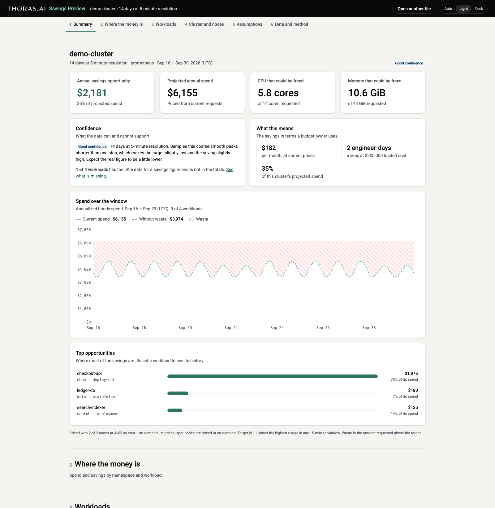

# Thoras Savings Preview

Savings Preview is a read-only command-line tool that shows what Thoras would save on your Kubernetes clusters. It runs on your machine with your existing kubeconfig, reads the CPU and memory usage history your clusters already keep (from a Prometheus-compatible store or Datadog), or samples usage from metrics-server when there is none, and compares it with what your workloads request. It installs nothing in your clusters, changes nothing there, and uploads nothing.

You can open the report yourself, or collect the data with `--collect-only` and send the resulting `savings-preview.zip` to Thoras.

Savings preview is a free tool from [Thoras](https://www.thoras.ai). The source is public so the tool installs with one command and anyone can read exactly what it runs.

## Install

With [Homebrew](https://brew.sh), on macOS or Linux:

    brew install thoras-ai/tap/savings-preview

Upgrade with `brew upgrade savings-preview`.

Or run it with npx, which needs Node.js 20 or later:

    npx @thoras-ai/savings-preview@latest check --context my-cluster

The package downloads the release binary of the same version on first use, checks it against the release's `checksums.txt`, and keeps it in `~/Library/Caches/savings-preview` on macOS or `~/.cache/savings-preview` on Linux (`SAVINGS_PREVIEW_CACHE` to change). `npm install -g @thoras-ai/savings-preview` puts `savings-preview` on `PATH` instead.

Or use the install script:

    curl -fsSL https://github.com/thoras-ai/savings-preview/releases/latest/download/install.sh | sh

`install.sh` picks the archive for this machine (macOS or Linux, amd64 or arm64), checks it against the release's `checksums.txt`, and installs `savings-preview` into `~/.local/bin` when that is on `PATH`, or `/usr/local/bin` otherwise. It asks before using sudo, and stops without installing anything when a checksum is missing or does not match. Set `VERSION=v0.2.7` to install a release other than the latest, and `INSTALL_DIR` to install somewhere else:

    curl -fsSL https://github.com/thoras-ai/savings-preview/releases/latest/download/install.sh | VERSION=v0.2.7 INSTALL_DIR=~/bin sh

Or download an archive from the [release page](https://github.com/thoras-ai/savings-preview/releases/latest), check it with `shasum -a 256 -c checksums.txt --ignore-missing`, and put the `savings-preview` binary on `PATH`. [Install from the archive](docs/getting-started.md#install-from-the-archive) has the steps, including the macOS download flag.

## Quick start

Check first. With the same flags as a run, `check` answers in a few seconds whether the run can work and how well. It reads no history and writes nothing:

    savings-preview check --context my-cluster

It prints the identity your kubeconfig gives, whether that identity may make each request the run needs, whether metrics-server answers, each Prometheus-compatible store it finds and how far back its data goes, whether Datadog keys are valid, and which source the run would read. The last line sums it up: `ready`, `limited` (it will work, with less history or detail) or `cannot run`.

Then run it:

    savings-preview --context my-cluster

It finds each cluster's source, prints a plan of what it will read and write, and waits for Enter; `q` or Ctrl-C quits without reading anything. It then reads the usage history, writes the files, and opens the report in your browser. To read several clusters into one report, give `--context` more than once, or use `--contexts-file FILE` or `--all-contexts`:

    savings-preview --context prod-us --context prod-eu --context staging

What you get, in the folder you ran it from:

- `savings-preview.zip`: `report.html`, a copy of the report that opens from disk in any browser, a short `summary.json`, and the usage data at 15-minute steps.
- `savings-preview.compact.otlp.json`: the usage data at 15-minute steps, which the report reads.
- `savings-preview.otlp.json`: the full-resolution data. It stays on your machine and is not in the zip.

The report opens on the annual saving and its share of what your current requests cost, today next to Thoras, and three workloads before and after. Details for engineers break the saving down by namespace, workload and node, and show every assumption. The target for each workload is 1.1 times its highest use in any 15 minutes, and waste is the request above that target. A workload counts only while it runs, and each cluster's yearly figures are its average over the time observed. Workloads in Thoras's own namespaces, `thoras` and `thoras-console`, are left out, so a cluster that already runs Thoras shows only its own workloads; Assumptions can include them. Nodes are priced by instance type from their cloud's list prices, the way the Thoras product prices them. You can change the headroom, the peak window, the prices and the namespaces in the report, and every figure follows.

[docs/quickstart.md](docs/quickstart.md) is the one-page version of these steps. [docs/getting-started.md](docs/getting-started.md) covers every source, the report section by section, and troubleshooting.

## Sending results to Thoras

To send your results to Thoras instead of opening the report yourself, add `--collect-only`. It reads and writes the same files, then exits without opening a browser, and its last line says which file to send:

    savings-preview --context my-cluster --collect-only

Send `savings-preview.zip` to your Thoras contact. [docs/send-to-thoras.md](docs/send-to-thoras.md) walks through it step by step, including what the zip contains.

## Security and what it reads

The tool only reads. It uses your kubeconfig credentials to list services and Prometheus Operator resources to find a store, queries the store through the API server's service proxy, and, when it has to poll, lists pods, ReplicaSets, Deployments, StatefulSets, nodes and metrics-server usage. It never reads Secrets, ConfigMaps or logs, and writes nothing in the cluster. It sends nothing anywhere except requests to your API server, to the metrics store, cloud monitoring API or Datadog API you point it at (with the token requests their credentials need), and, in a terminal, one check for a newer release on `github.com` that carries nothing about your clusters.

[docs/security.md](docs/security.md) lists every request, what the output contains and how releases are built. [docs/cluster-load.md](docs/cluster-load.md) covers how much load a run puts on your metrics store and API server, and how to limit it on a large cluster. [deploy/rbac/](deploy/rbac/README.md) has read-only ServiceAccounts for each source if you would rather not use your own credentials.

## Documentation

- [Quickstart](docs/quickstart.md): install, check, run and share, on one page.
- [Getting started](docs/getting-started.md): every install method, each source, many clusters, reading the report, and troubleshooting.
- [Sending results to Thoras](docs/send-to-thoras.md): collect the data from your clusters and send the zip.
- [Security](docs/security.md): what the tool reads and writes, where its output goes, and how to check.
- [Load on your cluster](docs/cluster-load.md): what a run costs your metrics store and API server, and how to run on a large cluster.
- [Read-only access](deploy/rbac/README.md): ServiceAccounts and roles for each source.
- [Prometheus adapter](docs/prometheus-adapter.md): in-cluster stores, and Mimir, Grafana Cloud, Amazon Managed Prometheus, CloudWatch, Azure Monitor and Google Managed Prometheus.
- [Datadog adapter](docs/datadog-adapter.md): reading usage from the Datadog metrics query API.
- [Poll adapter](docs/poll-adapter.md): sampling metrics-server on a cluster with no usage history.
- [Node prices](docs/node-prices.md): how nodes are priced.
- [Contract](docs/contract.md): the format of the data file every adapter writes and the report reads.
- [Upgrading](docs/upgrading.md) and the [changelog](CHANGELOG.md): what changed in each release.

## License

Savings Preview is licensed under [Apache 2.0](LICENSE). It is not a community project, so pull requests are not accepted.

## Developing

Building from source, the report page, fixtures and tests are described in [docs/development.md](docs/development.md).
